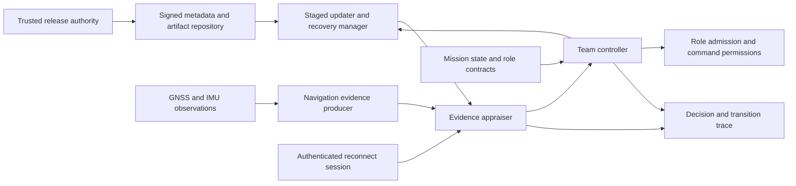
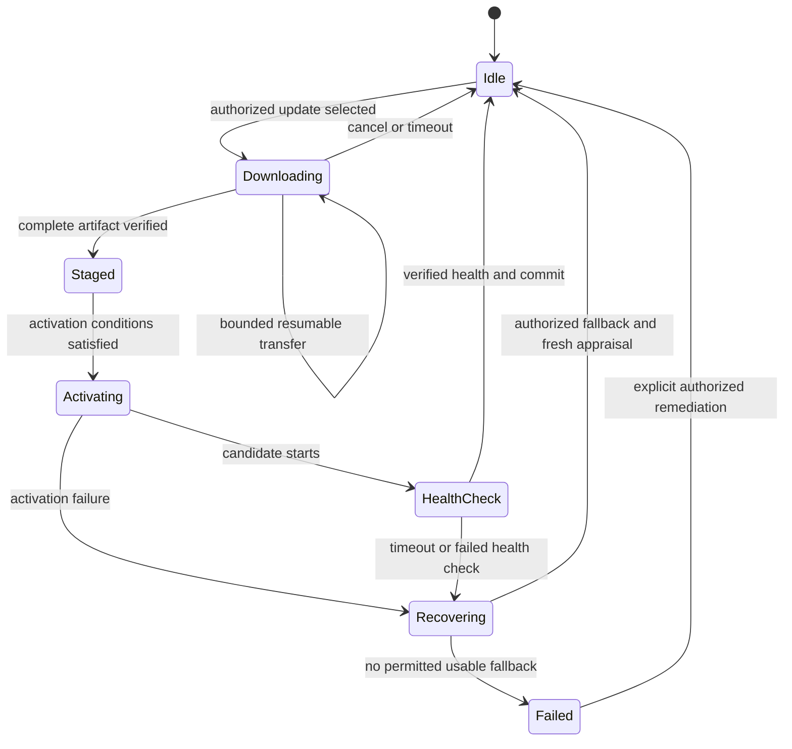

# Proposed system design

Status: design candidate A, joining GNSS evidence, secure updates, and swarm rejoining; no implementation exists. Requirements here are project choices, not a claim of TUF, Uptane, SUIT, or RATS conformance.

The six update requirements in [ADR 0002](decisions/0002-update-mvp-requirements.md) were accepted by Samet on 2026-11-10. They fix the companion mission/coordination application as the update target, the authority/trust-anchor model, mandatory verification, interrupted-transfer behavior, permitted fallback, and conservative handling of insufficient freshness evidence. Other interfaces and the final research question remain provisional.

## Component boundaries

The MVP models a trusted coordinator and release authority. Separate the updater, evidence appraisal, and role permissions even if they initially run in one Python process. Policies consume appraised evidence; the simulation evaluator alone can read hidden ground truth.

## Independent state dimensions

**Connectivity:** `CONNECTED`, `DISCONNECTED`, `RECONNECTING`.

**Update lifecycle:** `IDLE`, `DOWNLOADING`, `STAGED`, `ACTIVATING`, `HEALTH_CHECK`, `RECOVERING`, `FAILED`.

**Admission:** `ISOLATED`, `OBSERVATION`, `RESTRICTED`, `FULL`.

Do not compress all three dimensions into one numeric trust score. Recovery and update states do not automatically grant mission permissions. `ISOLATED` blocks cooperative mission commands while preserving an explicitly bounded management/recovery channel where authorized.

## Reconnection and remediation sequence

1. Establish an authenticated session for a registered identity and issue a fresh challenge tied to the mission and session.
2. Collect software and navigation evidence with provenance, collection age, and confidence limits.
3. Appraise software evidence against signed release metadata, permitted measurements, persisted security state, and the mission's role compatibility contract.
4. Classify which actions are admissible. Invalid signatures, revoked authorization, unknown essential evidence, or prohibited epochs block mission admission.
5. Among feasible actions, select a role, update/defer choice, or authorized recovery. If no safe mission action exists, keep isolation and record the service deficit.
6. Reappraise evidence after activation or recovery. Expire permissions when the underlying evidence expires or the mission contract changes.

## Update lifecycle

Navigation evidence enters role eligibility directly. It may also enter activation conditions if the defined mission maneuver or update target depends on reliable position. This second dependency must be modeled and tested explicitly; software updating does not inherently require GNSS.

Network loss during download must not alter the active image. An activation failure must not be recorded as success. A successful boot is insufficient for mission admission without post-activation checks. Whether these are atomic persistent operations must be verified when moving beyond simulation.

## Metadata and evidence contract to implement

| Object | Planned contents | Trust boundary |
| --- | --- | --- |
| Release authorization | Artifact digest/size, target class, component, protocol/role compatibility, security epoch, metadata sequence, validity, signer identity | Validated against preprovisioned authority keys; fields covered by signature |
| Device software evidence | Device/session/challenge binding, active artifact measurement, update phase, boot result, evidence age | Simulated trusted measurement agent first; a device self-report is a weaker experiment condition |
| Navigation evidence | Measurement time and time source, innovation statistic, uncertainty/covariance, sample age, monitor configuration, quality flags | Confidence is evidence about navigation, not cryptographic proof of location |
| Mission contract | Mission identifier/version, permitted role-release combinations, location requirements, minimum capability, recovery rules | Authenticated coordinator policy, versioned and bound to decisions |
| Decision record | Appraised inputs, policy/configuration version, admissible actions, selected action, reason codes, permission expiry, transition times | Append-only run trace; independent evaluator supplies outcome labels |

The first implementation should reuse maintained signature libraries, verify exact serialized bytes, and test tampering. An illustrative JSON object with `signature_valid: true` must never be presented as implemented cryptographic verification.

## Hard constraints before utility

Construct a feasible action set first. Software authorization, evidence freshness, prohibited security epochs, role compatibility, and role-specific navigation requirements are hard constraints. Optimize useful service, update cost, and recovery delay only among feasible actions. Mission urgency cannot make a bad signature acceptable.

For a small team, start with exhaustive action enumeration over a short horizon. Compare a simple rule policy before adding optimization libraries. Report solver timeouts and use a defined conservative fallback. Minimum team capability may be impossible to maintain; preserve security and report the shortfall rather than silently relaxing constraints.

## Recovery without a downgrade vulnerability

Maintain separate concepts for **release identifier**, **metadata sequence**, and **security epoch**. A lower release identifier may be a permitted fallback only if it remains authorized, meets the persistent security floor, is compatible with the selected role, and passes fresh health/evidence checks.

Do not advance an irreversible floor before verifying that the candidate or an authorized recovery image remains bootable. A security-floor increase that invalidates the old slot requires a suitable recovery strategy; if no permitted recovery image works, mission admission must fail. The recovery manager cannot reset counters to make an obsolete image acceptable.

This is a modeling obligation, not a proven implementation. Include crash points around persistent state updates when the recovery model is implemented.

## Time and freshness

Distinguish session freshness, measurement age, release metadata expiration, and knowledge of the newest available release. A nonce binds a response to a session; it does not reveal a suppressed newer release. GNSS time must not serve as the only trusted clock in GNSS spoofing scenarios. Use an explicitly modeled independent time source or bounded uncertainty and define the resulting conservative behavior. Unlimited isolation prevents claims of both guaranteed latest-release knowledge and unrestricted availability.

## PX4 stage

Use the [official multi-vehicle guide](https://docs.px4.io/main/en/sim_gazebo_gz/multi_vehicle_simulation) as a starting point, then pin an actual PX4 revision and simulator environment. The proposed update target is a companion service; restarting that service is not equivalent to flashing the flight controller. Check actual message-signing support in the chosen stack rather than assuming protocol support means it is enabled. See the [MAVLink guide](https://mavlink.io/en/guide/message_signing.html).
