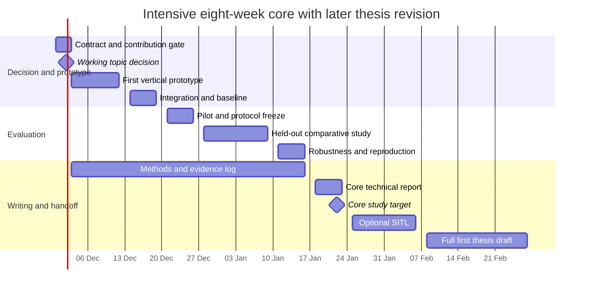

# Roadmap and team

Replanned: **2026-11-27**. Team: **Samet Ünsal, Ceren Tolunay, Halil Abacı**. Verified accounts: [CONTRIBUTORS.md](../CONTRIBUTORS.md).

May 2027 remains provisional. About six months remain; the official deadline, first-semester assessment and hardware expectations need confirmation. At Samet's request, the core research/prototype/study target is now **eight weeks: 30 November 2026-22 January 2027**, followed by optional integration and thesis revision. This assumes all three authors can work concurrently and reuse the existing research artifacts; availability is not yet quantified. These are intensive targets, not agreed appointments or completed work. No missed gate is retroactively complete.

## Direction and ownership

Work toward [navigation-qualified recovery planning](14-recovery-and-role-contract.md), a proposed T1/T5 refinement using navigation-evidence continuity as a shared prerequisite. The [worked decision analysis](../research/reports/Originality_Assessment_2026-11-27.md) supplies a draft contract and nominal-versus-contingency example; cross-check it rather than recreate it. Decide its contribution by **2 December**. Do not research all six candidates indefinitely. A new optimizer is conditional on a real baseline limitation.

Keep the accepted Linux companion mission-application target, ground-only activation/recovery with landed/disarmed evidence and an interlock, five to eight abstract agents, one mission, one navigation model and a small release/role table. Flight-controller updating, new cryptography and hardware attestation are outside the starting scope. PX4 SITL follows a credible core study only if feasible.

| Lead | Owns | Handoff / cross-review |
| --- | --- | --- |
| Samet Ünsal | Real update verification, release authorization/freshness, staged activation, health, permitted recovery and continuity integration | Versioned states, crash behavior and traces; Halil reviews transitions, Ceren reviews navigation invalidation |
| Ceren Tolunay | GNSS/IMU evidence, producer/monitor continuity, uncertainty, faults and calibration | Justified observations and independent position/error model; Samet reviews time/session assumptions, Halil reviews role requirements |
| Halil Abacı | Mission/roles, competent B3, candidate policy, team capacity, independent labels and comparative analysis | Worked decisions and evaluator; Ceren reviews physical eligibility, Samet reviews hard security gates |
| All three | Closest work, integration, thesis and reproducibility | Cross-review one shared end-to-end trace; write methods/limitations continuously |

Owners are proposed, not new GitHub assignments or recorded acceptance. Workstreams can proceed in parallel once they share a contract; three unrelated demos do not meet the integration goal.

## Calendar and exit criteria

| Phase / working dates | Deliverable / lead | Exit evidence and dependencies |
| --- | --- | --- |
| **G0: 30 Nov-2 Dec 2026** | All: check the existing contribution assessment and A-F hand traces; freeze one mission, evidence/role contract v0.1 and competent B3 | Record go/narrow/pivot, observable provenance and justified GNSS assumptions. Reuse available notes; log material unknowns and advisor questions rather than starting six new literature tracks |
| **M1: 3-11 Dec 2026** | Samet: real package verification and modeled staged recovery; Ceren: one navigation/truth generator; Halil: deterministic mission/B3 loop | One clean reconnect and failed activation/authorized fallback end to end, behavioral tests and rejected stale grants/prohibited images. Explicitly separate real verification from simulated navigation/activation. Depends on G0 contract |
| **M2: 14-18 Dec 2026** | All: event ordering, evidence invalidation, permissions and simple P only if justified | Check A-F against independent truth. Distinguish app-only/producer restarts; give B3 identical observations/gates/options. No new optimizer or second monitor for this milestone |
| **G1: 21-25 Dec 2026** | Ceren: model checks; Halil: paired pilot; Samet: recovery/crash tests and provenance feasibility | Fix validity defects; check B3 equivalence. Freeze scenario subset, practical margins, risk criteria, run counts and compute budget. If these cannot be justified, move final runs rather than relabel pilots as confirmation |
| **M3: 28 Dec 2026-8 Jan 2027** | Halil coordinates paired held-out runs; all inspect failures | Frozen revision/protocol, independent truth, raw traces/seeds and failed/censored runs; uncertainty and negative outcomes retained. Adjust working days to actual holiday/university availability |
| **M4: 11-15 Jan 2027** | Ceren: age/calibration sensitivity; Samet: recovery/provenance edges; Halil: limited ablations | Explain main failure/equivalence regions and reproduce the minimal study. Target-device and SITL measurements are separate, not prerequisites for an honestly bounded abstract study |
| **M5: 18-22 Jan 2027** | All: core technical report, figures, limitations and reproduction package | Another-author rerun attempt, evidence-backed conclusions and a complete methods/results draft. This is the eight-week core target, not a claim that the university thesis is submission-ready |
| **Optional M6: 25 Jan-5 Feb 2027** | Samet leads bounded 2-3 vehicle SITL; all support | Attempt only with stable core results and available environment. Separate abstract, crypto and SITL evidence; no physical-safety claim. Cut at the end of this window if integration threatens writing |
| **M7: 8-26 Feb 2027** | All: complete first thesis draft | Integrate introduction, related work, methods/results and limitations; adapt semester deliverables to the actual university schedule |
| **Mar-May 2027, by confirmed deadline** | All: advisor revisions, any necessary validity repair, formatting and defense | Confirm deadline early; reserve this period for review/reproduction/submission, not an expanded research scope. Hardware conclusions still require actual target measurements |

## Roadmap diagram

Bars end on the day after each planned work period. Milestones are targets; no official submission day is asserted.

## Next three working days: 30 November-2 December

| Owner | Next inspectable artifact | Tracking |
| --- | --- | --- |
| Samet | Check the authored D01 dependency/recovery table and traces against actual installer paths, retained images, schema compatibility and authority changes | [R01 #1](https://github.com/mathissdupont/swarm-rejoin/issues/1), [R02 #2](https://github.com/mathissdupont/swarm-rejoin/issues/2), [D01 #12](https://github.com/mathissdupont/swarm-rejoin/issues/12) |
| Ceren | Validate or refute the worked U/V recovery-readiness distinction using one monitor/model; check retained history/buffer alternatives, justified age/error assumptions and clean/faulted traces | [R03 #3](https://github.com/mathissdupont/swarm-rejoin/issues/3), [D01 #12](https://github.com/mathissdupont/swarm-rejoin/issues/12); administrative closure of #3 does not settle validation |
| Halil | Check demand timing, real useful roles, independent labels and nominal/generic contingency-aware B3 versus P; keep an equivalence case | [D03 #13](https://github.com/mathissdupont/swarm-rejoin/issues/13), [R04 #4](https://github.com/mathissdupont/swarm-rejoin/issues/4) |
| All | Cross-review, topic/contribution decision and advisor answers on empirical contribution, deadline and hardware | [R05 #10](https://github.com/mathissdupont/swarm-rejoin/issues/10), [R06 #11](https://github.com/mathissdupont/swarm-rejoin/issues/11) |

Use the existing notes and designed traces as drafts to verify, not as a reason to restart the literature review. Samet checks the update/provenance assumptions, Ceren supplies the smallest justified navigation model, and Halil checks role decisions concurrently. Do not rewrite Samet's completed standards notes simply to keep research open. Remaining acceptance work is source/contract cross-review and an explicit contribution decision. Optional candidates are parked unless the gate identifies a need.

## Rhythm and stop rules

During the eight-week core, propose a brief daily artifact/blocker update and one weekly 30-45 minute cross-review, recorded with the [meeting template](../research/templates/meeting-note.md). Neither daily nor weekly meetings have been scheduled by this document. Keep dated assumptions, source reading depth and configuration decisions.

- At G0, if the mechanism is ordinary reacquisition already supplied by competent B3, drop the new-policy claim. Retain a justified C1/C3 empirical thesis only with advisor acceptance, or reconsider the assessed T3 alternative.
- At G1, if benefit requires an artificial reset, unavailable provenance or relaxed gates, stop that claim. Keep negative results; do not weaken B3.
- Do not wait indefinitely for inaccessible papers. Retain acquisition gaps and conditional claims where missing material matters.
- Freeze the confirmatory protocol before M3. Changes after observing results require disclosure and separate exploratory analysis.
- Cut optional SITL/complexity before fair baselines, sensor validity, failure reporting or writing. Hardware conclusions require target measurements.
- Write from the first prototype. Freeze confirmatory study features at G1 on 25 December; later validity fixes require a new recorded revision and, where needed, reruns. Optional SITL stays outside the core comparison.
- If available effort or model validity cannot support the intensive dates, reduce optional scope first and reforecast explicitly. Do not skip security tests, calibration checks or independent labeling to preserve a calendar claim.
