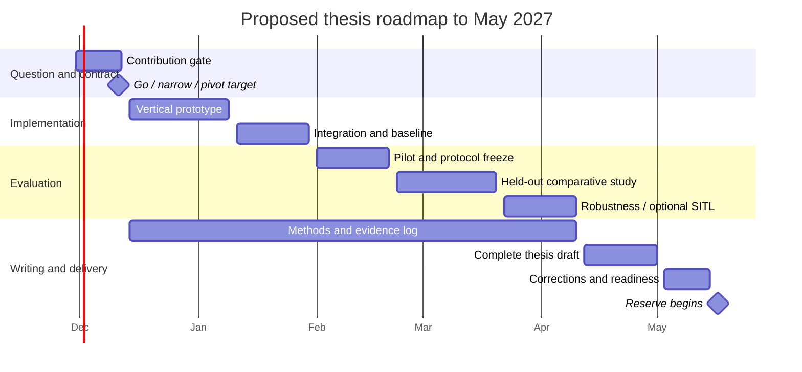

# Roadmap and team

Replanned: **2026-11-27**. Team: **Samet Ünsal, Ceren Tolunay, Halil Abacı**. Verified accounts: [CONTRIBUTORS.md](../CONTRIBUTORS.md).

May 2027 remains provisional. About six months remain; the official deadline, first-semester assessment and hardware expectations need confirmation. These dates are working targets, not agreed appointments or completed work. This replaces the 24 October calendar; no missed gate is retroactively complete.

## Direction and ownership

Work toward [navigation-evidence continuity across secure updates and swarm re-admission](12-contribution-and-decision-gate.md), a proposed T1/T5 narrowing. Decide its contribution by **11 December**. Do not research all six candidates indefinitely. A new optimizer is conditional on a real baseline limitation.

Keep the accepted Linux companion mission-application target, ground-only activation/recovery with landed/disarmed evidence and an interlock, five to eight abstract agents, one mission, one navigation model and a small release/role table. Flight-controller updating, new cryptography and hardware attestation are outside the starting scope. PX4 SITL follows a credible core study only if feasible.

| Lead | Owns | Handoff / cross-review |
| --- | --- | --- |
| Samet Ünsal | Real update verification, release authorization/freshness, staged activation, health, permitted recovery and continuity integration | Versioned states, crash behavior and traces; Halil reviews transitions, Ceren reviews navigation invalidation |
| Ceren Tolunay | GNSS/IMU evidence, producer/monitor continuity, uncertainty, faults and calibration | Justified observations and independent position/error model; Samet reviews time/session assumptions, Halil reviews role requirements |
| Halil Abacı | Mission/roles, competent B3, candidate policy, team capacity, independent labels and comparative analysis | Worked decisions and evaluator; Ceren reviews physical eligibility, Samet reviews hard security gates |
| All three | Closest work, integration, thesis and reproducibility | Cross-review one shared end-to-end trace; write methods/limitations continuously |

Owners are proposed, not new GitHub assignments or recorded acceptance. Workstreams can proceed in parallel once they share a contract; three unrelated demos do not meet the integration goal.

## Calendar and exit criteria

| Phase / working dates | Deliverable / lead | Exit evidence and dependencies |
| --- | --- | --- |
| **G0: 30 Nov-11 Dec 2026** | All: [contribution assessment](12-contribution-and-decision-gate.md), six hand traces, evidence/role contract v0.1 and closest-work cross-review | Observable provenance, justified GNSS assumptions, competent B3/P comparison. Record go/narrow/pivot and actual advisor response; no gap claim from a failed search |
| **M1: 14 Dec 2026-8 Jan 2027** | Samet: update/recovery core; Ceren: navigation/truth generator; Halil: one deterministic mission and B3 | One clean reconnect and one failed activation/authorized fallback end to end; security/recovery behavioral tests, rejected prohibited images and stale grants. Depends on G0; accommodate university/holiday availability |
| **M2: 11-29 Jan 2027** | All: event ordering, evidence invalidation, permissions, simple P if justified | A-F checked against independent truth; app-only versus producer restart distinguished; B3 has identical observations/gates/options. Prepare semester material on the actual university schedule |
| **G1: 1-19 Feb 2027** | Ceren: model checks; Halil: paired pilots; Samet: target selection and resource measurements if available | Correct modeling bugs; test credible B3 equivalence. Freeze confirmatory scenarios, practical margins, risk criteria and run counts using precision/cost needs. No positive-result requirement |
| **M3: 22 Feb-19 Mar 2027** | Halil coordinates paired held-out runs; all inspect failures | Frozen code/configuration/analysis, independent truth, raw traces/seeds and failed/censored runs; uncertainty and negative outcomes retained |
| **M4: 22 Mar-9 Apr 2027** | Ceren: calibration/age sensitivity; Samet: recovery/provenance edges; Halil: ablations; optional 2-3 vehicle SITL | Separate abstract, measured crypto and SITL evidence. SITL needs reproducible M3 and available environment; drop it if it threatens analysis. No physical-safety claim from SITL |
| **M5: 12-30 Apr 2027** | All: complete thesis draft, figures, limits and rerun instructions | Full readable draft and another-author reproduction attempt/review. Writing begins in M1; feature freeze except validity fixes |
| **M6: 3-14 May 2027** | All: advisor corrections, formatting, presentation and archive | Resolve review, rerun minimal reproducer in recorded environment, check citations/licenses and submission rules |
| **Buffer: 17 May-official deadline** | All: final corrections and administration | Submit by confirmed deadline. Move M5/M6 earlier if necessary; do not consume the reserve with added scope |

## Roadmap diagram

Bars end on the day after each planned work period. Milestones are targets; no official submission day is asserted.

## Next ten working days

| Owner | Next inspectable artifact | Tracking |
| --- | --- | --- |
| Samet | Dependency table for app/producer/configuration/frame/time, A-D traces and OTA/RobOTAP/RASUES comparison | [R01 #1](https://github.com/mathissdupont/swarm-rejoin/issues/1), [R02 #2](https://github.com/mathissdupont/swarm-rejoin/issues/2), [D01 #12](https://github.com/mathissdupont/swarm-rejoin/issues/12) |
| Ceren | One monitor/model with justified age/error assumptions, continuity/warm-up conditions and two annotated navigation traces | [R03 #3](https://github.com/mathissdupont/swarm-rejoin/issues/3), [D01 #12](https://github.com/mathissdupont/swarm-rejoin/issues/12); administrative closure of #3 does not settle validation |
| Halil | One mission/useful-role table, independent eligibility rules and B3/P hand decisions for A-F including equivalence | [D03 #13](https://github.com/mathissdupont/swarm-rejoin/issues/13), [R04 #4](https://github.com/mathissdupont/swarm-rejoin/issues/4) |
| All | Cross-review, topic/contribution decision and advisor answers on empirical contribution, deadline and hardware | [R05 #10](https://github.com/mathissdupont/swarm-rejoin/issues/10), [R06 #11](https://github.com/mathissdupont/swarm-rejoin/issues/11) |

Do not rewrite Samet's completed standards notes simply to keep research open. Remaining acceptance work is source/contract cross-review and an explicit contribution decision. Optional candidates are parked unless the gate identifies a need.

## Rhythm and stop rules

Propose one weekly 30-45 minute artifact/blocker review, recorded with the [meeting template](../research/templates/meeting-note.md). No recurring meeting has been scheduled by this document. Keep dated assumptions, source reading depth and configuration decisions.

- At G0, if the mechanism is ordinary reacquisition already supplied by competent B3, drop the new-policy claim. Retain a justified C1/C3 empirical thesis only with advisor acceptance, or reconsider the assessed T3 alternative.
- At G1, if benefit requires an artificial reset, unavailable provenance or relaxed gates, stop that claim. Keep negative results; do not weaken B3.
- Do not wait indefinitely for inaccessible papers. Retain acquisition gaps and conditional claims where missing material matters.
- Freeze the confirmatory protocol before M3. Changes after observing results require disclosure and separate exploratory analysis.
- Cut optional SITL/complexity before fair baselines, sensor validity, failure reporting or writing. Hardware conclusions require target measurements.
- Write from the first prototype; freeze features in April except documented validity fixes.
