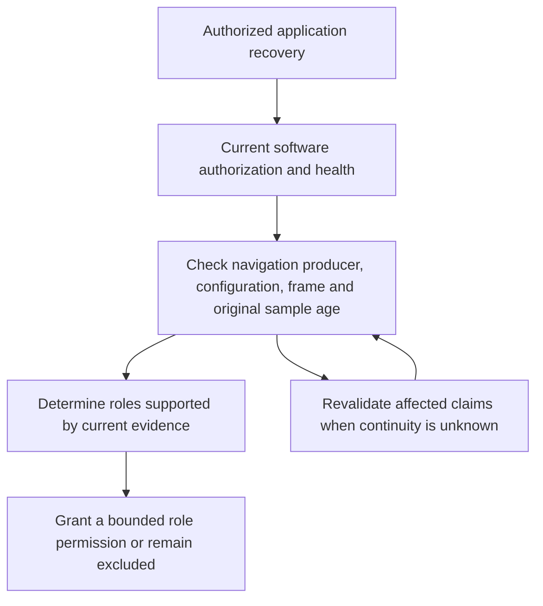

# Team brief: the idea and its originality test

Prepared: **2026-11-27** for **Samet Ünsal, Ceren Tolunay and Halil Abacı**. Discussion material, not a record of a meeting, team acceptance or advisor approval. The question is proposed; originality and benefits are unproven. This note has not been sent to anyone.

## The idea in ninety seconds

We study a UAV returning to a swarm after a connection loss and an authorized mission-application update or recovery. A valid software release, a healthy application and usable navigation are separate requirements. They can change at different times.

Our proposed model tracks which navigation claims remain usable when the application, navigation producer, configuration or reference frame changes. It then appraises the vehicle for a specific swarm role using current evidence and unchanged security constraints. The flight-controller estimator may continue while the companion application restarts; preserving that continuity must not mean trusting an old position sample.

The [concrete follow-up](../research/reports/Originality_Assessment_2026-11-27.md) uses this shared contract before activation too: assess which roles remain feasible if the update fails and the authorized fallback succeeds. A recovered application may be healthy before its navigation evidence qualifies it for the next mission phase. The [D01 draft](14-recovery-and-role-contract.md) specifies that decision and a hand-worked example. A generic contingency-aware planner is a required comparator; it may already make the same choice.

We want to determine whether this explicit model exposes important cross-component failures and supports better service decisions than a competent static policy. We will share fault traces, independent truth and reproducible comparisons. We are investigating a contribution, not announcing the first secure swarm updater or a proven new algorithm.

## A concrete episode

Consider a six-vehicle search mission. One member disconnects, returns, lands and attempts an authorized mission-application update. The candidate fails its health check, so the updater uses a still-authorized, compatible fallback. Activation/recovery requires confirmed landed/disarmed state and an interlock, following [ADR 0003](decisions/0003-companion-deployment-and-ground-activation.md).

The recovered application starts a new session. That does not settle whether its navigation evidence is current or appropriate for its next role:

| What actually happened | Required interpretation |
| --- | --- |
| The estimator continued, its configuration/frame stayed compatible, and current output is available | Rebind the application session, check current evidence and reappraise the role; an application restart alone does not justify a filter reset |
| The application returns an old navigation sample inside a newly authenticated response | Judge the original sample's age and context; a fresh response does not refresh its contents |
| The producer restarted or its configuration/frame changed | Invalidate the dependent claims and follow the selected monitor's justified initialization/revalidation rules |
| Software and evidence context appear valid but GNSS/IMU output is misleading | The independent evaluator may still label a granted role unsafe; the contract is not a universal spoofing detector |

After appraisal, the vehicle may be eligible for a defined role or remain excluded. A role counts as useful only if its actual capability, location, release compatibility and mission requirements support it. We do not assume a landed relay provides search coverage or that a granted role authorizes takeoff during activation.

Every stage retains its own failure/unknown outcome. Software authorization failure blocks the affected action; mission utility cannot override it. Provenance initially relies on an honest modeled producer and a protected collection boundary, not demonstrated hardware attestation.

## Where originality could reside

The strongest candidate is a **precise model of interactions between software recovery, navigation-evidence continuity and swarm-role admission, with a falsifiable comparative evaluation**. The [contribution proposal](12-contribution-and-decision-gate.md) separates model/counterexamples (C1), a possible policy (C2), and the reproducible study (C3).

| Item | Current interpretation |
| --- | --- |
| Signatures, artifact hashes, secure-update metadata and fallback storage | Reused mechanisms; not our invention |
| A GNSS confidence threshold, rejecting stale samples or waiting for reinitialization | Ordinary mechanisms do not establish novelty by themselves |
| A dependency graph or context-bound permission | Design choices with prior art; adding fields is insufficient as a contribution |
| A demonstrated cross-component failure with a precise scope, assumptions and nearest-work comparison | Potential scientific contribution if it is materially distinct and explained rather than merely asserted |
| A policy improving useful service over an equally informed and constrained comparator | Potential method contribution; requires fair held-out evidence, cost reporting and independent risk labels |
| A useful joint-fault characterization, including equivalence or negative results | Possible empirical thesis contribution; distinct coverage and advisor acceptance must be established |

Nearest work already includes [swarm OTA/recovery](../research/literature/notes/varadharajan2018.md), [RobOTAP's authenticated transfer](../research/literature/notes/robotap2024.md), and [RASUES's update/state-appraisal integration](../research/literature/notes/usman2026.md). Their individual notes state examined sections and unresolved details. Full review of every related protocol is not complete. We cannot claim that no previous study addresses our remaining question.

## The test that prevents a weak novelty claim

Give B3 the same evidence, release authorizations, hard constraints, roles and recovery options as our proposal. Let it obtain current estimator output, preserve an uninterrupted estimator and perform competent continuity checks. Do not force an artificial reset or delay on it.

Before selling C2 as a new method, answer all of these:

1. **Specific difference:** Which justified event trace makes P choose differently from B3? Show both decisions; an unsafe cache baseline is insufficient.
2. **Observable basis:** Which actual producer/time/configuration evidence supports the distinction? Unknown provenance cannot be guessed into existence.
3. **Nearest-work distinction:** What do examined sections already solve, and what remains different? Unread material stays unknown; a search miss is not an absence result.
4. **Measured consequence:** Does the difference improve useful service or eligible-role delay under unchanged gates, without concealing unsafe admissions or extra cost? The experiment is still future work.
5. **Refutation:** Would equivalence, unavailable provenance, unsafe extra service or lost benefit on held-out cases make us withdraw the claim? The answer must be yes.

Currently we have a candidate model, literature notes and designed traces. We have no implemented P/B3 comparison, measured benefit, completed model check or established new algorithm. That is why we should present an originality hypothesis rather than an originality conclusion.

## What each person should challenge next

- **Samet:** Can the update/recovery component preserve current authorization and supply the session/provenance distinctions needed by the model? Check the dependency table and traces A-D.
- **Ceren:** Which GNSS/IMU monitor and error/age assumptions are justified? Which state survives an application-only restart, and which changes invalidate it? Supply clean/faulted expectations, including faults that evade the monitor.
- **Halil:** Which roles contribute real mission capability? Can a competent B3 already make the same decisions? Supply one differing or equivalent trace with independent eligibility labels.
- **Together:** Check the claim against the nearest work and ask the advisor whether C1/C3 with a negative C2 is sufficient. The accelerated working decision target is **2 December 2026**; see the [roadmap](07-roadmap-and-team.md).

Samet has explicitly prioritized originality. If the advisor/team requires a new method and this candidate supplies only routine integration, we should narrow or change the candidate before substantial implementation. We must not present an empirical fallback as a demonstrated algorithmic innovation. The already assessed [T3 alternative](../research/reports/R08_T3_Navigation_Configuration_Assessment.md) also needs its own novelty check before adoption.

## Three questions for the team discussion

1. Can we express the proposed distinction with one hand-checked trace against a competent comparator?
2. Can we obtain and justify the navigation evidence that this distinction requires?
3. What contribution type will we accept if the proposed policy is equivalent to B3, and what would trigger a topic change?

Record actual answers and disagreements when discussed. Do not mark a meeting or approval complete because this briefing exists.
