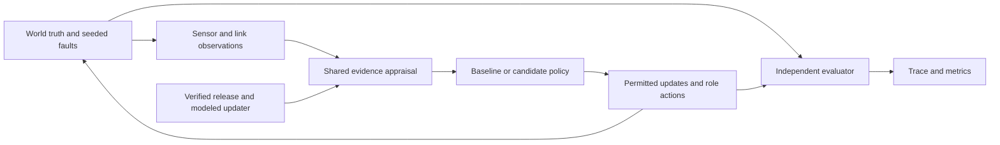

# Implementation handoff: owners, simulation and development environment

Prepared: **2026-11-27** for **Samet Ünsal, Ceren Tolunay and Halil Abacı**. PR #20 was merged at Samet's request. Its merge publishes the research artifacts; it does not establish originality, peer acceptance or implemented UAV behavior.

**Executable follow-up:** The [prototype quickstart](16-prototype-quickstart.md) now runs a bounded verification/lifecycle/role fixture. The work below remains the broader handoff: motion/GNSS models, comparative policies, real process recovery and PX4 are pending. This fixture does not mark the 2 December model/contribution gate complete.

## When coding can start

**Start reusable implementation work now:** environment/dependency recording, event/data types, deterministic trace loading, real update-verification tests and an evaluator skeleton. These support either a positive or negative research outcome. Do not wait for a proven novelty claim before building the tools needed to test it.

**By 2 December:** settle one mission/role table, one defensible navigation/monitor model, the [D01 evidence/recovery contract](14-recovery-and-role-contract.md) and baseline assumptions. Record unresolved assumptions and the working contribution decision. The integration target starts **3 December**, with one end-to-end vertical slice by **11 December**, as in the [roadmap](07-roadmap-and-team.md). Dates are working targets, conditional on actual progress.

The new-policy implementation is conditional on a justified distinction from competent B3. Generic contingency-aware B3 and the common test harness are useful even if that distinction disappears. The hand-worked U/V case must not be hard-coded to manufacture an advantage. Advisor contribution-type approval and final topic acceptance remain separate from permission to build reversible exploratory infrastructure.

## Each person's next work

Module/file names below are proposed destinations, not existing implementations. Work owners are proposed; team acceptance is not inferred.

| Owner | Before joint integration | First code deliverable | Acceptance evidence |
| --- | --- | --- | --- |
| **Samet Ünsal** | Trace candidate/active/retained-image paths, current authorization/floor and schema compatibility through success/failure. Check where application-owned navigation history changes | `updates` and shared `evidence` types: real metadata/artifact verification using the assessed Python-TUF candidate, bounded staged-transfer/activation model, authorized fallback and health events | A valid local release is accepted; altered bytes/signature, wrong target, prohibited epoch and incomplete payload are rejected; interrupted transfer preserves active image; failed activation cannot grant a role. Tests keep keys/credentials outside Git |
| **Ceren Tolunay** | Select one GNSS/IMU/monitor model with units, noise/bias assumptions, sampling/time semantics and reset/history behavior. Validate or refute the U/V readiness distinction, including state-retention alternatives | `navigation` plus truth/observation trace generator: clean trajectory and controlled GNSS loss/bias, IMU drift, stale samples and separate application/producer restarts | Annotated clean/faulted traces, independently recorded position error, reproducible seed and justified monitor behavior. No arbitrary random trust score or invented warm-up chosen to favor P |
| **Halil Abacı** | Fix one search/coverage mission, useful roles, demand over time, release/role compatibility, deadline/launch costs and independent eligibility labels | `simulation`, `policies` and `evaluation`: deterministic event loop, nominal B3 and generic contingency-aware B3 variants, paired scenario runner and metrics | Same exogenous faults/observations/gates/options across policies; no policy access to hidden truth; correct grant/shortfall/delay denominators; an equivalence case and an infeasible-demand case |
| **All three** | Cross-check D01 and one complete hand trace rather than writing another unrelated literature summary | Connect the modules through one event/trace format | Another author can replay the same scenario from configuration/seed/revision and explain every action and rejected alternative |

Samet should begin with the existing [R02 library assessment](../research/reports/R02_Verification_Library_Assessment.md), not design a new signing protocol. Python-TUF covers update metadata/artifact verification; installation, project compatibility, health, recovery and mission fitness remain separate responsibilities. Freeze actual package versions when executable code is added. Its verification clock must have an explicit trusted-host-time assumption or a tested adapter; GNSS fault injection must not silently alter or bypass metadata expiration.

## Simulation layer 1: a reproducible research model

Start with **six virtual vehicles, one coordinator and a 2D search/coverage mission** in a Python process. A vehicle is a stateful model, not a separate operating system or physical drone. Scale to five/eight vehicles during later sensitivity tests.

1. **World truth:** trajectory/position, navigation faults, actual app/release/update state, authorization events and mission progress. Only the evaluator sees the hidden truth needed for outcome labels.
2. **Observations:** Ceren's sensor/monitor model produces GNSS/IMU-derived evidence, original sample times, uncertainty/validity and producer/configuration context. GNSS faults and communication faults are separate generators; a link outage does not imply GNSS loss.
3. **Events:** reconnect, observation arrival/ageing, staged transfer, activation, health failure, permitted fallback, evidence revalidation and permission expiry. Use a simulated clock, deterministic ordering/tie breaking and recorded seeds. Do not wait real minutes to simulate a minute-long outage.
4. **Actions:** defer, stage an update, activate under the modeled landed/disarmed interlock, recover to an authorized image, and grant/withdraw a currently eligible role. Record launch/landing costs if future airborne capability is planned; grounded vehicles do not provide airborne coverage.
5. **Policies:** fixed/count-limited context, nominal B3, generic contingency-aware B3 and P only where justified. Baseline variants remain distinguishable in run configuration. They receive the same evidence and budgets.
6. **Outputs:** append-only event/decision traces, independent unsafe-role labels, mission-capability shortfalls, eligible-service delay, update/recovery outcomes and cost. Retain denied/censored/failed runs.

The first sensor abstraction may be simple, but its assumptions and validity must be stated. A fixture containing a supplied quality value can test plumbing; it cannot validate a GNSS detector or the scientific benefit. Once the chosen model exists, derive evidence from observations and compare against separate truth.

### What is real versus modeled

| Layer 1 item | Required interpretation |
| --- | --- |
| Metadata signatures, payload digest/size and authenticated project fields | Use actual signed bytes and maintained verification code; a Boolean fixture is not a verifier |
| Radio outages, sensor error and vehicle movement | Explicit synthetic models until calibrated/validated against an identified source or data |
| Activation time, ground interlock, crash points and fallback lifecycle | Simulated operational behavior initially; not evidence of a crash-safe Linux installer or physical arming enforcement |
| Persistent security-state protection and evidence producer honesty | Stated model assumptions; no hardware root of trust demonstrated |
| U/V recovery-readiness difference | A hypothesis to test; keep cases where it is absent or both policies agree |

### First end-to-end acceptance scenario

Use six agents and a deterministic configuration. A returning member reconnects and stages a genuinely verified release. A partial transfer leaves its active image intact. At a later allowed ground transition, activation fails and an authorized compatible fallback starts. Its application session changes; current navigation evidence is appraised and the requested role is granted only if its present prerequisites hold. Repeat with stale evidence, prohibited fallback and continuing versus reset producer contexts.

Run the same exogenous trace through nominal and contingency-aware baselines. If both choose the same action as P, record equality. The first milestone proves integration behavior for that scenario, not a research advantage or flight safety.

## Simulation layer 2: real companion-service lifecycle

After the event model works, exercise a small mission service as an actual Linux process: stage a signed package, stop/start the service, probe health and use a permitted retained version. Keep updater/recovery management outside the process being replaced. Check storage/state commit and crash behavior before calling recovery robust. Local repository transport is sufficient initially; a radio or cloud backend is not required to verify bytes.

This stage measures actual process/verification behavior on the recorded host. Laptop/WSL timings are not target-companion or flight-controller benchmarks. A representative onboard Linux target and its resource budget still need selection before deployment-feasibility claims.

## Simulation layer 3: bounded PX4/Gazebo case study

First demonstrate one vehicle, then two, then optionally three. Integrate a separate companion mission service with pinned PX4/SITL and Gazebo versions. Check telemetry identity, time/reset semantics, disconnect/reconnect, landed/arming state and service recovery. Choose MAVLink/MAVSDK or ROS 2 only after checking which interface supplies the required evidence; ROS 2 is not required for the initial Python study.

Restarting the companion application is not flight-controller firmware updating. GNSS injection must occur at a documented sensor/evidence boundary and be distinguished from falsifying simulator truth. Check actual estimator behavior; a decorative simulator scene is not navigation validation. SITL validates selected integration paths, not hardware attestation, electrical power-loss recovery or physical flight safety.

The current roadmap puts this optional stage after the core study, **25 January-5 February 2027**. A small smoke test may be attempted earlier without blocking the core model; no full simulator migration is required before Python work starts.

## Do we need Linux?

| Work | Practical environment |
| --- | --- |
| Layer 1 Python model, analysis and most unit tests | Windows or Linux; keep paths/process assumptions portable |
| Layer 2 actual companion-service process lifecycle | Linux; WSL2 Ubuntu is suitable for initial development, with target hardware validation later |
| Layer 3 PX4/Gazebo multi-vehicle simulation | Linux environment. PX4 documents Ubuntu and a Windows WSL2 route; native dual boot is not required merely to begin |

Local read-only check on **2026-11-27** found Windows Python **3.14.2** and registered WSL2 distributions named **Ubuntu** and **docker-desktop**, both stopped. This confirms distribution registration only. Ubuntu release, Python packages inside it, graphics/network operation, PX4 installation and successful Gazebo simulation were not checked. No distribution was installed/upgraded or simulator launched by this handoff.

Recommendation: begin portable Python work on the existing machine; use Ubuntu under WSL2 for Linux process tests and later SITL. Check the Ubuntu release before choosing a version-matched toolchain. Current rendered [PX4 Ubuntu guidance](https://docs.px4.io/main/en/dev_setup/dev_env_linux_ubuntu) lists Ubuntu 24.04/22.04 and Gazebo Harmonic. The [archived source snapshot](../research/library/px4-ubuntu-setup/README.md) is older and lists different Ubuntu versions; it is not asserted to match current rendered instructions. Pin the actual PX4 revision, matching setup documentation, Ubuntu and Gazebo versions when starting SITL.

The [official WSL2 guide](https://docs.px4.io/main/en/dev_setup/dev_env_windows_wsl) describes PX4 development on Windows through Ubuntu; the [multi-vehicle guide](../research/library/px4-multi/README.md) is already retained. See the [new WSL source record](../research/library/px4-wsl-setup/README.md) for captured-version limits. No separate official PDFs were located for these setup pages.

For Linux development, use a dedicated Linux clone such as `~/src/swarm-rejoin` and a separate virtual environment; do not reuse the Windows `.venv` as a Linux environment. Keep the PX4 checkout separate as well. Docker is optional, not an initial dependency. Install/pin project dependencies with the first implementation rather than treating the inspection-only environment as a reproducible project setup.

## Exit from preparation

By the integration start, retain: one shared contract revision, one mission/role table, one selected navigation model with its limits, one nominal/contingency baseline specification, real verification test cases and one common scenario/configuration. Build from those artifacts. Keep related-work maintenance and thesis writing alongside coding; do not restart a general literature search to postpone every implementation task.
